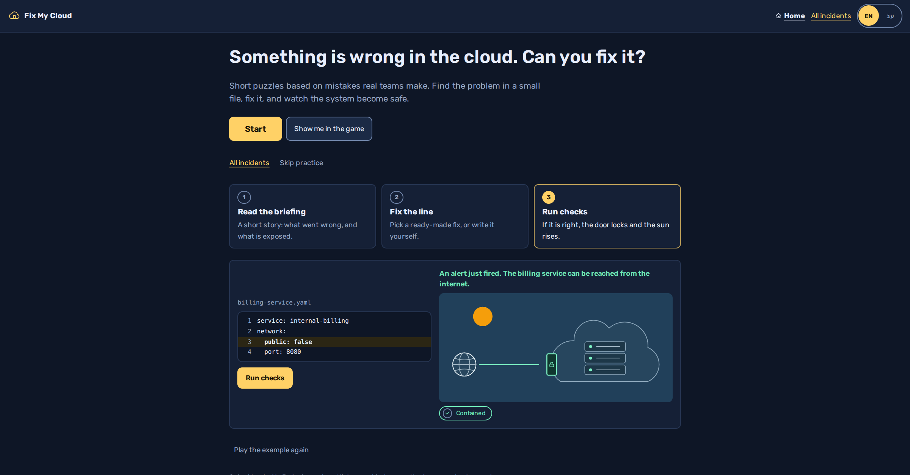
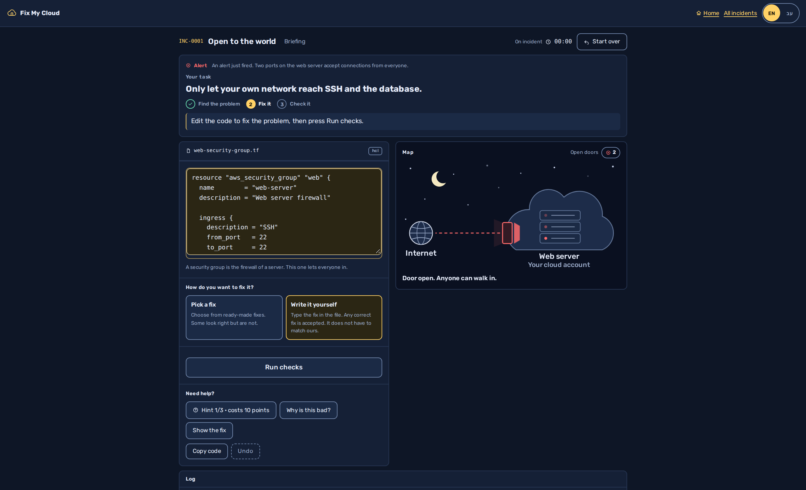
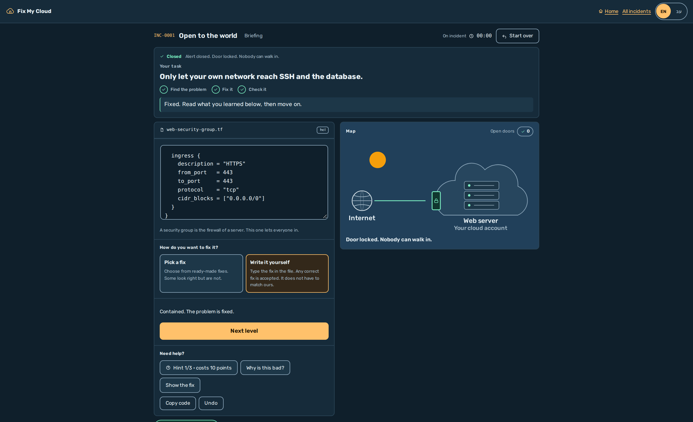
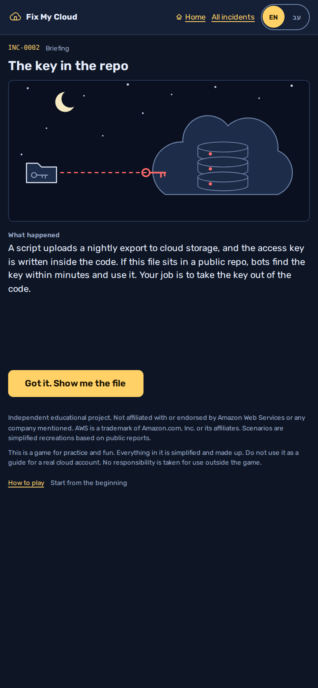

<div align="center">

# Fix My Cloud

**Real incidents. Simplified. Can you fix them before they spread?**

A free browser game that teaches DevOps and cloud best practices.<br>
You are the on-call engineer. Find the mistake, fix it, and watch the night turn into dawn.

[](https://github.com/Kinanw38/fix-my-cloud/actions/workflows/ci.yml)
[](https://github.com/Kinanw38/fix-my-cloud/actions/workflows/pages.yml)


**[Play it live](https://Kinanw38.github.io/fix-my-cloud/)**



</div>

## What it is

Each level is a small, fictional recreation of a mistake that really hurts teams: a firewall open to the world, a key
written in code, a CI script that runs a stranger's text, a database with no guards. You read a short briefing, find the
bad line in a tiny config file, fix it (pick a ready-made fix or type your own), and run the checks. If it is right, the
door locks and the sun rises. Then you see your change as a pull request and what you learned.

- 8 short levels, 1 to 7 minutes each. No signup, no cloud account.
- Hebrew and English, with right-to-left layout. Works on phone and desktop.
- 100% in the browser. No server, no tracking, no cookies.

<p align="center">
  
  
</p>
<p align="center">
  
</p>

| Level | Topic |
|---|---|
| Practice 1 and 2 | The mechanics: flip a setting, pin a version |
| INC-0001 Open to the world | A firewall rule open to everyone |
| INC-0002 The key in the repo | A cloud key written in code |
| INC-0003 The PR title that ran commands | Untrusted text inside a CI script |
| INC-0004 The destroy that ate production | A database with no guards |
| INC-0005 The metadata service | A tricked app and an over-powerful role |
| INC-0006 The label that vanished | A deprecated Kubernetes label |

## Run it locally

Needs Node 20 or newer.

```bash
npm ci
npm run serve      # open http://localhost:8000/
npm test           # unit tests
npm run e2e        # real browsers (Chromium and Firefox)
```

## How it is built

Plain HTML, CSS and JavaScript modules. No framework and no runtime dependencies. The only dev tools are Playwright
(browser tests) and axe (accessibility checks).

- `src/rules/` checks the player's code. Pure functions, no DOM.
- `src/levels/` one file per level: the code, hints, fix choices and lesson.
- `src/ui/` the screens. `styles/` the design tokens and styles.

Details: [docs/HOW_IT_WORKS.md](docs/HOW_IT_WORKS.md). To add a level: [docs/ADD_A_LEVEL.md](docs/ADD_A_LEVEL.md).

## CI/CD in this repo

| What | Where |
|---|---|
| Tests run on every push and pull request (unit, privacy scan, Chromium and Firefox, accessibility) | `.github/workflows/ci.yml` |
| Deploy to GitHub Pages only after the tests pass, then check that the live site answers | `.github/workflows/pages.yml` |
| Strict Content-Security-Policy, self-hosted fonts, no CDN | `index.html`, `assets/fonts/` |

## Disclaimer

Independent educational project. Not affiliated with or endorsed by Amazon Web Services or any company mentioned.
This is a game for practice and fun. Everything in it is simplified and made up. Do not use it as a guide for a real cloud
account. See [NOTICE.md](NOTICE.md).

## License

[PolyForm Noncommercial 1.0.0](LICENSE): personal study, hobby use, research and teaching are allowed. Commercial use is not.
The Rubik font keeps its own license (SIL OFL 1.1, `assets/fonts/OFL-Rubik.txt`).

Built by Ron Keinan.
